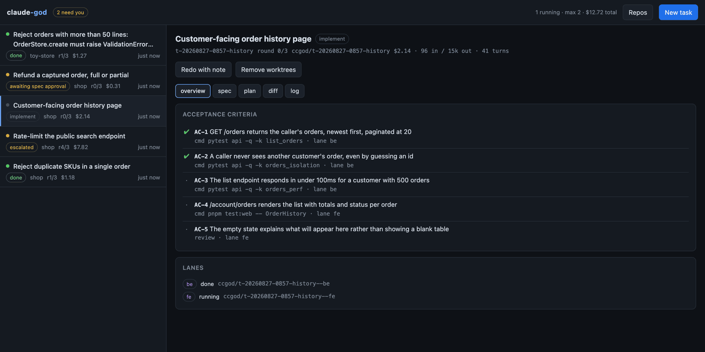
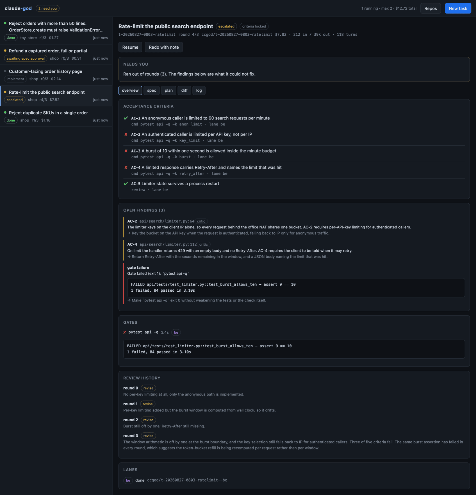
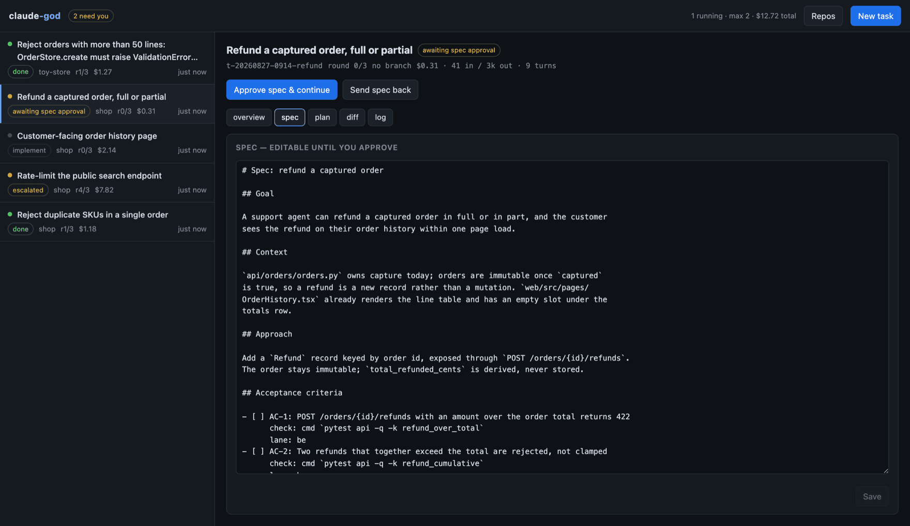
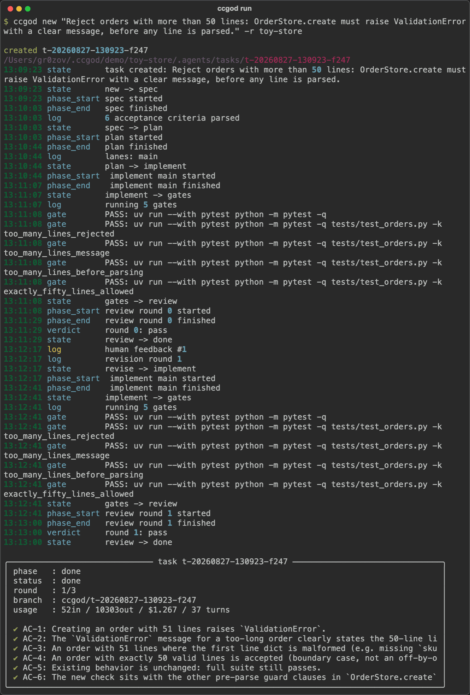
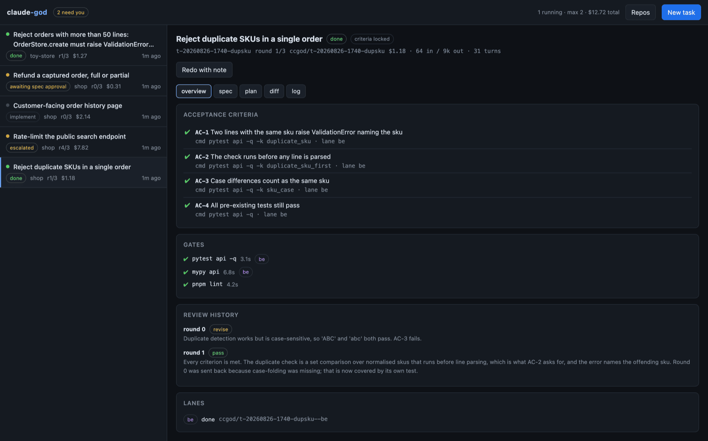
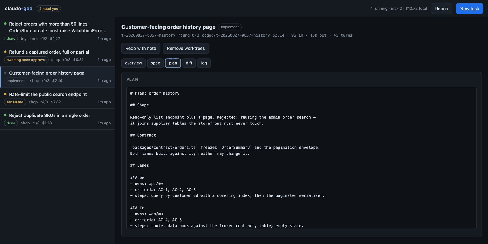
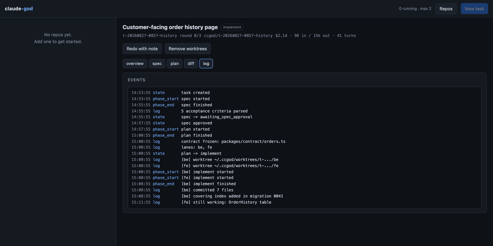

# claude-god

[](https://github.com/grozoww/claude-god/actions/workflows/ci.yml)

Runs a dev task end to end with multiple Claude agents: **spec → plan → implement
(parallel lanes) → gates → critic → done**, with a bounded revision loop and a
dashboard to watch it and send work back.

A Python orchestrator drives headless `claude -p` sessions. Orchestration is plain
code, so the loop itself costs zero tokens — only the phase calls burn anything.

```
                 you approve
request → spec ──────┬──────→ plan + contract → ┌─ be ─┐
                     │                          │      ├→ integrate → gates ─┐
                  send back                     └─ fe ─┘                     │
                                                                     ┌───────┴──────┐
                            done ←── pass ── critic ←────────────────┤  all passed? │
                                             │                       └──────────────┘
                                          revise ──→ back to the lanes (max 3)
                                             │
                                       out of rounds → escalated → you
```

<p align="center">
  
</p>

## Why it is built this way

**State lives on disk, not in a conversation.** Agents get compacted and forget;
files do not. Every task is a folder, so a run survives a crash, the dashboard is
just a reader, and "send it back" is a file write.

**Gates before critics.** Build, typecheck and tests are objective and cheap, so
they run first. Most bad rounds die there without spending an agent turn.

**Criteria lock after round one.** From the first revision the critic may only judge
the existing acceptance criteria. Without this it finds fresh objections forever and
you pay forever.

<p align="center">
  
  <br><em>Out of rounds. Every finding names the criterion it violates — no criterion, no finding.</em>
</p>

**The contract is frozen before parallel work starts.** Two lanes that cannot see
each other will invent two different API shapes. The planner writes the shared types
into `contract/` first; lanes read it and may not change it.

**Human feedback is just another finding.** Your "redo" note enters the loop in the
same JSON shape a critic emits. One loop, one format, no special path.

## Install

Needs `claude` (logged in), `git`, `uv`, and Node for the dashboard.

```bash
./install.sh
```

That installs the dependencies, builds the dashboard, and puts `ccgod` on your
PATH. Re-run it any time to update.

| | |
|---|---|
| `./install.sh --dev` | also install pytest and ruff |
| `./install.sh --no-ui` | skip the dashboard build (API and CLI only) |
| `./install.sh --no-global` | leave PATH alone; use `uv run ccgod` |

It installs **editable**, so `ccgod` runs from this checkout — the agent prompts
live in `plugin/` and are found relative to the package. Move the directory and
re-run the script.

To undo it:

```bash
./uninstall.sh
```

That removes the `ccgod` command and the build output, and leaves your data
alone. `--purge` also deletes `~/.ccgod` (repo registry, demo repos, worktrees),
detaching lane worktrees from your repos first so none are left with dangling
refs. Task folders inside your own repos are never touched.

<details>
<summary><b>Doing it by hand instead</b></summary>

```bash
uv sync                                    # --no-dev to skip pytest and ruff
cd ui && npm ci && npm run build && cd ..  # dashboard into server/ccgod/static
uv tool install --editable .               # optional: ccgod on your PATH
uv run ccgod doctor
```

</details>

## Try it on a sandbox

```bash
uv run ccgod demo
uv run ccgod new "reject orders with more than 50 lines" -r toy-store
```

`ccgod demo` copies the bundled toy repo to `~/.ccgod/demo/toy-store`, git-inits it and
registers it. The run stops for you to approve the spec; `--yes` skips that.

<p align="center">
  
  <br><em>The one gate worth having: approving a half-page spec costs a minute, a wrong spec costs three rounds of agents.</em>
</p>

<details>
<summary><b>The same run from the CLI</b></summary>

<p align="center">
  
</p>

Request to green diff, then a `ccgod redo` round that extracted a constant — the
real run, about two minutes and a dollar each way.

</details>

## Use it on your own repo

```bash
uv run ccgod init /path/to/repo     # writes .agents/ — review it, then commit it
uv run ccgod new "add order refunds" -r repo
uv run ccgod serve                  # dashboard on http://127.0.0.1:8787
```

Not on disk yet? `ccgod clone <url>` clones it and registers it in one step,
using your existing git credentials. The dashboard has a folder browser for
picking paths — a web page cannot read a real filesystem path, so the server
does the walking and labels each folder as *git repo*, *registered* or
*onboarded*.

`ccgod init` runs one agent that explores the repo and drafts:

| File | What it is |
|---|---|
| `.agents/project.md` | What the product **is** — glossary, architecture map, invariants |
| `.agents/lanes/<x>.md` | Per-lane stack, patterns, exemplar files |
| `.agents/config.json` | Lane paths, gate commands, base branch |

`CLAUDE.md` already covers *how to work in the repo* and is loaded automatically —
`project.md` fills the other gap.

### Project config

```json
{
  "base_branch": "main",
  "gates": ["pnpm test"],
  "lanes": {
    "be": { "paths": ["api/**"],  "gates": ["pnpm test:api", "pnpm tsc -b"] },
    "fe": { "paths": ["web/**"],  "gates": ["pnpm test:web"] }
  },
  "contract_dir": "packages/contract",
  "max_rounds": 3,
  "budget_usd": 5.0,
  "setup_cmd": "pnpm install"
}
```

Lane paths **must not overlap** — that is what keeps parallel agents off each
other's files. Single-stack repos should use one lane named `main`.

## Commands

```
ccgod demo                     copy the toy repo and register it
ccgod init <repo>              draft .agents/ for a repo
ccgod clone <url> [--into <d>] clone a repo and register it
ccgod new "<title>" -r <repo>  create and run a task
ccgod list [--all]             tasks across registered repos
ccgod show <id> -e 40          one task, with the last 40 events
ccgod spec <id>                print the spec
ccgod approve <id>             approve the spec and continue
ccgod redo <id> "<note>"       send it back with a note
ccgod cancel <id>              stop it
ccgod cleanup <id>             remove lane worktrees
ccgod archive <id>             hide it from the list, keep it on disk
ccgod rm <id> [--branch]       delete it for good
ccgod prune [--dry-run]        apply the retention policy now
ccgod usage                    token and cost rollup
ccgod repos add|list|rm        manage the repo registry
ccgod doctor                   check the environment

ccgod serve                    start the dashboard (detached)
ccgod status                   is it running?
ccgod restart                  stop and start again — picks up code changes
ccgod stop                     stop it
```

`serve` detaches and returns, so you get your terminal back; logs go to
`~/.ccgod/serve.log`. Use `--foreground` to keep it attached, and `--reload`
while working on the server (it implies `--foreground`).

## Applying changes

The install is editable, so most of the time there is nothing to do:

| You changed | What to run |
|---|---|
| Python or CLI code | nothing — the next `ccgod` picks it up |
| Server code, while it is serving | `ccgod restart` |
| `ui/` | `cd ui && npm run build`, then reload the page |
| Dependencies, or you pulled new commits | `./install.sh` |

For UI work, `cd ui && npm run dev` gives hot reload on :5173, proxied to the
API on :8787.

## Housekeeping

Finished tasks are removed automatically. Two rules, per repo, whichever bites
first — keep the newest 50, and drop anything untouched for 30 days:

```json
// ~/.ccgod/config.json
{ "retention": { "enabled": true, "max_tasks": 50, "max_age_days": 30 } }
```

A task that is still running is never pruned, and one that never reached a
terminal phase is spared unless you pass `--unfinished`. Set either limit to `0`
to switch that rule off, or `enabled: false` for neither.

`ccgod prune --dry-run` shows what would go. The server also prunes at startup
and once a day. Deleting a task removes its folder and worktrees; its git branch
survives unless you ask for `--branch`.

Archiving is the softer option: `ccgod archive <id>` hides a task from the list
but leaves it on disk. Retention still applies to archived tasks — that is the
difference between archiving and keeping something forever.

<details>
<summary><b>More screens</b></summary>

<p align="center">
  
  <br><em>Done, after one revision round. The review history keeps every verdict.</em>
</p>

<p align="center">
  
  <br><em>The plan and the per-lane briefs. Each lane agent sees only its own.</em>
</p>

<p align="center">
  
  <br><em>Every phase transition, streamed live from <code>events.jsonl</code>.</em>
</p>

</details>

## Cost

Runs on your Claude subscription through the CLI — no API key, no per-token bill.
What it spends is your plan's rate window, so:

- `max_parallel` (default 2) caps concurrent `claude` processes.
- A rate-limited phase **parks** the task and retries when the window resets. State
  is on disk, so parking is free.
- `budget_usd` per task or per repo stops a run that overspends.
- `models` in project config picks a model per phase.
- `ccgod usage` and the dashboard header show what has been spent.

A small single-lane task on the toy repo costs roughly $1 and takes about two
minutes end to end.

## Task folder

```
.agents/tasks/<id>/
  state.json        phase, round, criteria, verdict, usage — the source of truth
  spec.md           requirements + acceptance criteria (editable before approval)
  plan.md           lane split and order
  contract/         frozen interface, read-only for lanes
  lanes/<x>.md      per-lane brief
  reviews/round-N.json
  feedback/N.md     your notes
  artifacts/        raw agent replies per phase
  events.jsonl      append-only log, tailed live by the dashboard
```

Kept out of your git history automatically.

## Spec format

The parser reads checkbox items under `## Acceptance criteria`:

```markdown
- [ ] AC-1: POST /orders returns 422 on a bad payload
      check: cmd `pnpm test -- orders.spec.ts -t 422`
      lane: be
- [ ] AC-2: the empty cart state matches the design
      check: review
- [ ] AC-3: it feels responsive on a slow connection
      check: human
```

`cmd` checks are run as gates. `review` goes to the critic. `human` never blocks the
automated loop. A criterion that cannot take a check is not a criterion.

## The plugin

`plugin/` holds the role rules as skills — one source of truth, used two ways:

- The orchestrator embeds them into headless prompts.
- Install it in Claude Code to use the same roles interactively (`/task`, and the
  `god-planner` / `god-lane-dev` / `god-critic` / `god-integrator` subagents).

Edit `plugin/skills/*/SKILL.md` to change how a role behaves everywhere at once.

## Notifications

```json
// ~/.ccgod/config.json
{ "notify_cmd": "osascript -e 'display notification \"$CCGOD_TASK_TITLE\" with title \"$CCGOD_PHASE\"'" }
```

Fires on `done`, `escalated`, `failed` and `awaiting_spec_approval`, with
`CCGOD_TASK_ID`, `CCGOD_TASK_TITLE`, `CCGOD_PHASE`, `CCGOD_REPO` in the environment. The
dashboard also raises a browser notification when its tab is open.

## Safety

- Headless runs use `--permission-mode acceptEdits` with an explicit tool allowlist.
  `--dangerously-skip-permissions` is never used.
- The critic gets read-only tools. A critic that can edit what it reviews is no
  longer independent of it.
- Work happens on a `ccgod/<task-id>` branch, never on your base branch. Lane
  worktrees live under `~/.ccgod/worktrees/`.

## Development

```bash
uv run pytest server/tests -q       # 78 tests, no tokens spent
uv run ruff check server scripts    # lint
cd ui && npm run dev                # dashboard on :5173, proxies to :8787
ccgod serve --foreground --reload   # API on :8787, restarts on code changes
```

CI runs the same three on every push and PR: pytest on Python 3.11 and 3.13,
ruff, and the UI typecheck plus build. Dependabot opens weekly grouped PRs for
pip and npm, monthly for Actions. React and Vite are each grouped with their
peers, because bumping half of either pair on its own fails `npm ci`.

The formatter is configured but not enforced — `ruff format` would rewrite
about 1200 lines across 17 files, so run it as its own commit if you want it.

The pipeline tests use a fake runner that writes the same files a real agent would,
so every transition, the gate→revise path, the criteria lock, escalation and the
parallel-worktree merge are covered without calling Claude.

To regenerate the screenshots (needs Chrome, and `ccgod serve --port 8799` running):

```bash
uv run python scripts/seed-screenshots.py   # demo tasks in every state
uv run python scripts/shoot.py              # dashboard shots
uv run python scripts/shoot-cli.py <task-id>
```

`seed-screenshots.py` writes task folders directly rather than running agents, so
`done`, `running`, `escalated` and `awaiting approval` can all be shown at once
without four real runs. `shoot-cli.py` replays a real task's event log, so the
numbers in that image are the ones that run actually produced.

## Layout

```
server/ccgod/      state machine, task store, runner, gates, worktrees, API, CLI
ui/              React dashboard → builds into server/ccgod/static
plugin/          skills and agent definitions
examples/toy/    sandbox repo used by `ccgod demo`
install.sh       one-command setup; uninstall.sh undoes it
scripts/         screenshot tooling for the README
docs/img/        the screenshots above
.github/         CI workflow and Dependabot config
PLAN.md          the build plan this was written against
```
